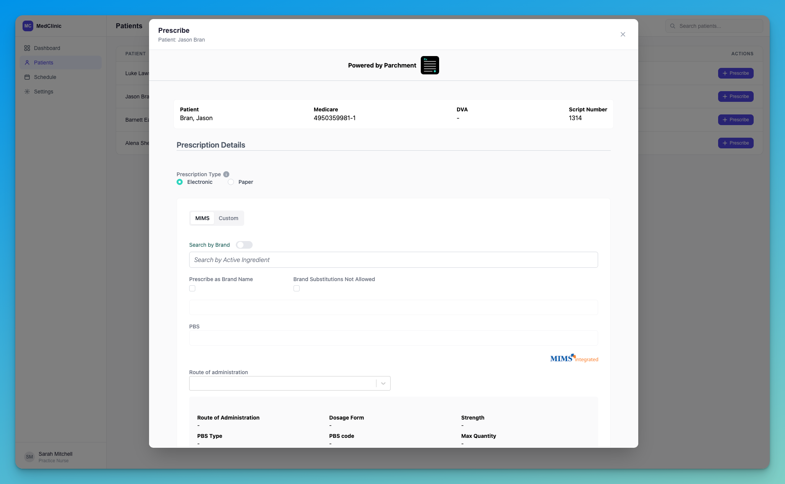

## Prerequisites

- Valid partner credentials (partner_id, partner_secret, organization_id, organization_secret)
- **Parchment SSO Integration**: You must first set up [Parchment SSO](/sso/sso-integration-generic) before implementing iframe embedding
- Your domain needs to be **whitelisted** in Parchment's environments


## Implementation Steps

### 1. Generate SSO Token with Embed Path

When generating an SSO token for iframe embedding, use the `/embed/` prefix in your redirect path:

> 🚀 **API Endpoint**
>
> ```
> POST /v1/sso
> ```

**Headers:**
- `x-partner-id`: Your partner ID
- `x-partner-secret`: Your partner secret
- `x-organization-id`: Target organization ID
- `x-organization-secret`: Organization secret
- `x-user-id`: Parchment user ID to authenticate
- `Content-Type`: application/json

**Request Body:**

```json
{
  "redirect_path": "/embed/patients/f03b972b-53ea-452d-ae48-024817f6c3b0/prescriptions"
}
```


<Note>
**Important:** The `/embed/` prefix in the redirect_path tells Parchment to render the page in iframe-optimized mode, removing navigation elements and adjusting the layout for embedded display.
</Note>

### Available Embed Paths

| Path | Description |
|------|-------------|
| `/embed/patients/{patient_id}/prescriptions` | Prescription form for a specific patient. Main entry point for creating new prescriptions. |
| `/embed/patients/{patient_id}/prescriptions/{prescription_id}` | View or manage an existing prescription for a patient. |
| `/embed/prescriptions/approval` | Approval dashboard for reviewing, approving, amending, or rejecting queued prescriptions. |

**Response:**
```json
{
  "success": true,
  "data": {
    "sso_token": "eyJ...",
    "redirect_url": "https://portal.parchment.health/auth/sso?token=eyJ...&redirect=%2Fembed%2Fpatients%2F...",
    "expires_in": 300
  }
}
```

### Query Parameters

The prescription form (`/embed/patients/{patient_id}/prescriptions`) accepts query parameters to **pre-fill** fields and to **pass partner data through to webhooks**. Append them to the `redirect_path` when generating the SSO token — they are preserved through the SSO redirect onto the embedded page:

```json
{
  "redirect_path": "/embed/patients/f03b972b-53ea-452d-ae48-024817f6c3b0/prescriptions?custom_drug_id=DRUG%2342&quantity=2&reserved_1=ORDER-9087"
}
```

<Note>
URL-encode all values (e.g. a space becomes `%20`, `#` becomes `%23`).
</Note>

#### Pre-fill parameters

| Parameter | Type | Constraints | Description |
|-----------|------|-------------|-------------|
| `custom_drug_id` | string | non-empty | Selects a custom drug from the organization catalog as the medication. |
| `quantity` | integer | 1–999 | Quantity to dispense. Must be a whole number. |
| `repeats` | integer | 0–99 | Number of repeats. |
| `repeats_interval` | integer | 1–365 | Minimum interval (days) between repeats. |
| `patient_instructions` | string | ≤ 250 chars | Directions for the patient. Longer values are truncated. |
| `doctor_instructions` | string | ≤ 50 chars | Note for the dispenser. Longer values are truncated. |

Invalid numeric values are ignored (a warning is shown in the form); over-length text is truncated.


#### Reserved parameters

Opaque pass-through values for partner use. They are shown **read-only** on the form and delivered on the resulting webhook in the top-level `metadata` object (see [Webhook Events](/webhooks/webhook-events)).

| Parameter | Type | Constraints | Description |
|-----------|------|-------------|-------------|
| `reserved_1` | string | ≤ 30 chars | Reserved partner data. Longer values are truncated. |
| `reserved_2` | string | ≤ 30 chars | Reserved partner data. Longer values are truncated. |
| `reserved_3` | string | ≤ 30 chars | Reserved partner data. Longer values are truncated. |

Each reserved field is independent of the pre-fill precedence above. A field only appears on the form (and is forwarded to the webhook) when it is present and non-empty; absent fields are delivered as `null`.

### V3 Parameters <Badge color="blue">Coming soon</Badge>

When the new prescription form (V3) is enabled for an organization, `/embed/patients/{patient_id}/prescriptions` redirects to `/embed/patients/{patient_id}/prescriptions-v3` with the query string intact. Use the same `redirect_path` for both forms.

#### Query parameters

The V3 form accepts every parameter above, plus MIMS medication selection and `indication`.

| Parameter | Type | Constraints | Description |
|-----------|------|-------------|-------------|
| `product_pack_id` | string | 1–64 chars, `A–Z a–z 0–9 _ -` | MIMS product pack to select as the medication. Needs `pbs_code` or `private=1`. |
| `pbs_code` | string | PBS item code, e.g. `1884E` | PBS listing for the selected pack. Not allowed with `private=1`. |
| `private` | boolean | `1`, `true`, `0`, `false` | `1` selects the pack as a private (non-PBS) prescription. |
| `brand` | boolean | `1`, `true`, `0`, `false` | `1` keeps the brand name on the prescription. |
| `custom_drug_id` | string | non-empty | Selects a custom drug from the organization catalog. Ignored when `product_pack_id` is valid. |
| `quantity` | integer | 1–999 | Quantity to dispense. |
| `repeats` | integer | 0–99 | Number of repeats. |
| `repeats_interval` | integer | 1–365 | Minimum interval (days) between repeats. |
| `patient_instructions` | string | ≤ 250 chars | Directions for the patient, entered as free text. |
| `doctor_instructions` | string | ≤ 50 chars | Note for the dispenser. |
| `indication` | string | ≤ 250 chars | Reason for prescribing, entered as free text. |
| `reserved_1` | string | ≤ 30 chars | Reserved partner data, returned on the webhook `metadata`. |
| `reserved_2` | string | ≤ 30 chars | Reserved partner data, returned on the webhook `metadata`. |
| `reserved_3` | string | ≤ 30 chars | Reserved partner data, returned on the webhook `metadata`. |

- The pack and PBS listing are looked up in MIMS. If they do not match, the form asks the prescriber to select the medication.
- `quantity`, `repeats` and the other field values apply after the medication is selected, so they override the medication's defaults.
- Invalid values are ignored and the form shows a warning. Over-length text is truncated.
- `template_id` is not supported on V3.
- The prescriber can change every pre-filled value before signing.

```json
{
  "redirect_path": "/embed/patients/f03b972b-53ea-452d-ae48-024817f6c3b0/prescriptions?product_pack_id=12345&pbs_code=1884E&quantity=30&repeats=2&indication=Hypertension&reserved_1=ORDER-9087"
}
```


**Example**

A telehealth partner wants to tie the resulting prescription webhook back to their own records — the booking it came from, the consultation, and the acquisition channel. They pass those as reserved fields when generating the SSO token:

```json
{
  "redirect_path": "/embed/patients/f03b972b-53ea-452d-ae48-024817f6c3b0/prescriptions?reserved_1=BK-2026-4471&reserved_2=consult_88213&reserved_3=app-ios"
}
```

When the clinician creates the prescription, Parchment echoes those exact values on the webhook's `metadata`, so the partner can reconcile the event against their booking system without any extra lookup:

```json
{
  "event_type": "prescription.created",
  "data": {
    "patient_id": "f03b972b-53ea-452d-ae48-024817f6c3b0",
    "partner_patient_id": "1523402100149593750",
    "user_id": "8e1c9bab-6614-4723-8981-87c8fa026dae",
    "scid": "2TM1XVXBJRWXH8NM68"
  },
  "metadata": {
    "reserved_1": "BK-2026-4471",
    "reserved_2": "consult_88213",
    "reserved_3": "app-ios"
  }
}
```

### 2. Embed in Your Application

Use the returned `redirect_url` as the iframe source:


```jsx
<iframe
  src={iframeUrl}
  className="absolute inset-0 size-full border-0"
  allow="clipboard-write; publickey-credentials-get *; publickey-credentials-create *"
  referrerPolicy="strict-origin-when-cross-origin"
  title="Parchment Portal"
/>
```

### Result



## Troubleshooting

### Blank page with "HTTP ERROR 431"

If the embedded iframe (or the portal itself) shows a blank page reading
**`HTTP ERROR 431` — Request Header Fields Too Large**, the browser has
accumulated too many Parchment authentication cookies on the
`parchment.health` domain and the request header has grown past the
server's size limit.

This almost always happens during **integration testing**, when the same
browser signs in many times in a short period — each sign-in can leave
behind cookies that aren't cleaned up. End-users who sign in occasionally
are very unlikely to see it.

<Warning>
This is a browser-side cookie limit, and the error is returned *before* the
page loads — so refreshing or navigating to another Parchment URL won't fix
it. The cookies have to be cleared.
</Warning>

<Steps>
  <Step title="Open cookie storage for the Parchment domain">
    Open **DevTools → Application → Cookies**, then select the
    `https://portal.<env>.parchment.health` entry.
  </Step>
  <Step title="Clear the Parchment cookies">
    Click **Clear all cookies** (🚫) to remove every cookie for that domain —
    in particular the `CognitoIdentityServiceProvider.*` entries.
  </Step>
  <Step title="Relaunch">
    Generate a fresh SSO token and load the iframe again. You'll sign in
    cleanly and the error will be gone.
  </Step>
</Steps>

<Note>
To avoid this entirely while testing, use an **incognito/private window**
(or a separate browser profile) for each round of sign-in testing — its
cookies are discarded when the window closes.
</Note>


